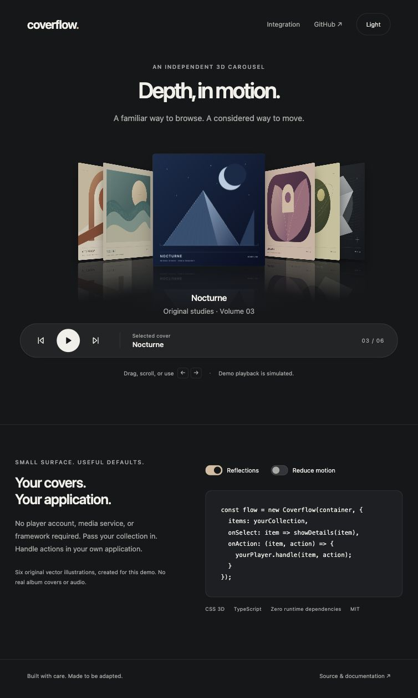

# Coverflow

An independent, framework-free 3D cover carousel. CSS perspective, spring motion, fading artwork reflections, pointer gestures and keyboard controls — in a small TypeScript component with zero runtime dependencies.

The demo uses six original vector cover studies and simulated playback. It has no music-service login, real recordings, lyrics or external album art.



## Run the demo

```sh
git clone https://github.com/NorthStarXyzz/coverflow.git
cd coverflow
npm ci
npm run dev
```

Open the local URL printed by Vite (normally `http://127.0.0.1:5176/`). Drag or scroll the covers, use the arrow keys, or press Enter to activate the selected cover. Playback in this demo only changes UI state.

## Use the component

The package is available from this GitHub repository; it has **not** been published to the npm registry.

```sh
npm install github:NorthStarXyzz/coverflow
```

Git installation runs the documented `prepare` build. You can also build a local package with `npm run build` and `npm pack`.

```ts
import { Coverflow } from '@northstarxyzz/coverflow';
import '@northstarxyzz/coverflow/style.css';

const flow = new Coverflow(document.querySelector('#covers')!, {
  items: [
    { id: 'first', title: 'First study', subtitle: 'Your collection', artwork: '/covers/first.svg' },
    { id: 'second', title: 'Second study', artwork: '/covers/second.svg' },
  ],
  onSelect(item, index, reason) {
    // Update your own detail view. This is selection, not playback.
  },
  onAction(item, action) {
    // Perform the action in your application. The host owns playback state.
    yourPlayer.handle(item.id, action);
  },
  onError(error) {
    console.error(error);
  },
});

flow.setPlayback({ id: 'first', isPlaying: true });
flow.select('second');
flow.setItems(updatedItems);
flow.dispose();
```

Give your container a width; the component provides a responsive default height. Customize `--cf-foreground`, `--cf-muted`, `--cf-focus`, and `--cf-card-radius` on `.cf-root`. See [API and behavior](docs/API.md) for all options and edge cases.

## What it handles

- Actual CSS 3D transforms: a frontal selected cover, tilted side stacks and Z-axis depth.
- Reflections of the artwork texture only; playback controls never appear in the reflection.
- Pointer drag with velocity-aware release, wheel browsing, arrow keys and Home/End navigation.
- Stable item identities across reorder/removal; repeated covers can use distinct occurrence IDs.
- Host-controlled playback via callbacks, with no optimistic invented playing state.
- Reduced-motion preference, focus feedback, meaningful names and a polite selection announcement.
- A bounded window of at most 15 live cards, no permanent idle animation, and explicit disposal.
- Safe text rendering and image placeholders for invalid or failed artwork URLs.

## Development

```sh
npm run verify
```

This typechecks the library and demo, runs contract tests, verifies original SVGs and hashes, builds the ESM package/declarations/CSS, and builds the static demo. `npm pack --dry-run` lists the distributable files. The GitHub workflow performs the same checks on Node 22 and 24.

## Source and design

The 3D geometry and motion concepts reference MIT-licensed coverflow examples, credited in [NOTICE](NOTICE) and [THIRD_PARTY_NOTICES.md](THIRD_PARTY_NOTICES.md). Presentation, generic glyphs and demo artwork are separate from proprietary client resources. Original asset inputs and review are documented in [artwork provenance](docs/ARTWORK.md).

Design review follows Apple’s public HIG principles for hierarchy, restrained materials, keyboard access, icon consistency and motion preferences, translated to a cross-platform web component. No Apple symbols, fonts, branded assets or hardware replicas are bundled. See [design notes](docs/DESIGN.md).

The host is responsible for the rights to its artwork and for its playback/service integration. This component itself has no service adapter, credential handling, media scraping, audio streaming or persistent media cache. It does not claim endorsement, pixel-perfect reproduction of a commercial app, or universal legal clearance.

## License

[MIT](LICENSE), with applicable third-party notices retained. The project license applies only to rights that the authors can grant; it does not license host-supplied media, brands or external services.
